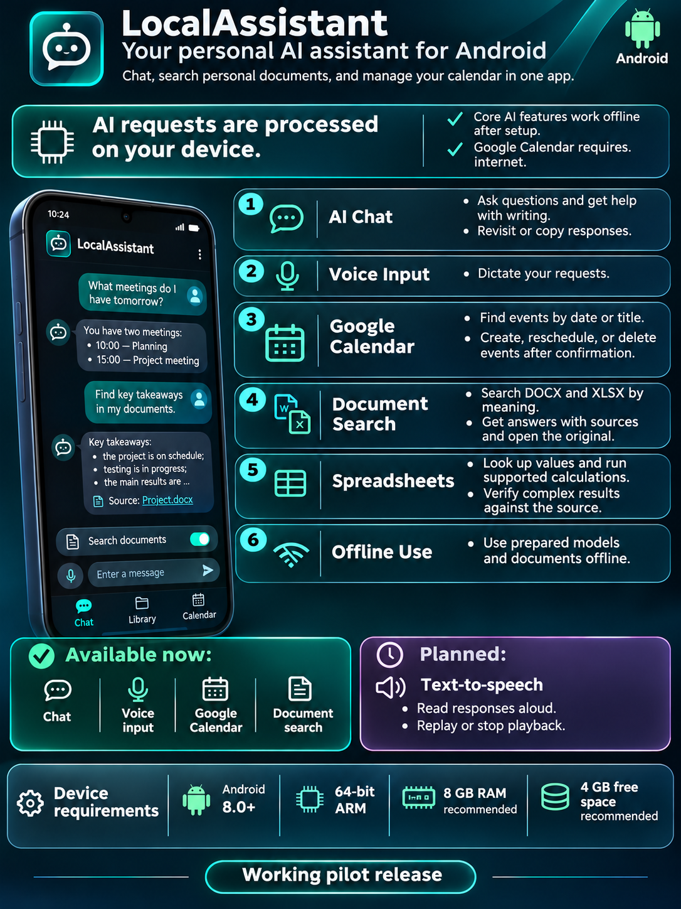

# LocalAssistant

LocalAssistant is an Android AI assistant for local chat, personal document search, and Google Calendar. Core AI features work offline once the models and documents are ready. Google Calendar requires a connection for account setup and synchronization.

## Features

- **Local chat and voice input.** Type or dictate a request, revisit your chat history, and copy responses.
- **Google Calendar.** Find events by date or title, and create, reschedule, or delete events after confirming the change.
- **DOCX and XLSX search.** Import files into the document library and enable document search in chat. Get a short answer with sources, request more detail, or open the original file.
- **Spreadsheet analysis.** Look up values in XLSX files and run supported numerical calculations.

## Run the app

1. Open the project in Android Studio and let Gradle sync.
2. Run the `app` configuration on a compatible Android device.
3. Set up the local chat model. See the [embedding model notes](docs/BUNDLED_EMBEDDING.md) for document search setup.
4. Connect your Google account to use Calendar.

## Device requirements

- Android 8.0 (API 26) or newer and a 64-bit ARM smartphone.
- Preliminary recommendations for the pilot are at least 8 GB of RAM and 4 GB of free storage. For larger documents or longer conversations, 12 GB of RAM is preferable.

## Project status

LocalAssistant is a pilot release. Check results from complex spreadsheets against the source file. Voice input is available, and text-to-speech for assistant responses is under evaluation.

## Project presentation

- English: [Full presentation](docs/local_assistant_presentation.en.txt)
- Russian: [Original presentation](docs/local_assistant_presentation.txt) and [original infographic](docs/Local_AI_Assistant_Android.png)
